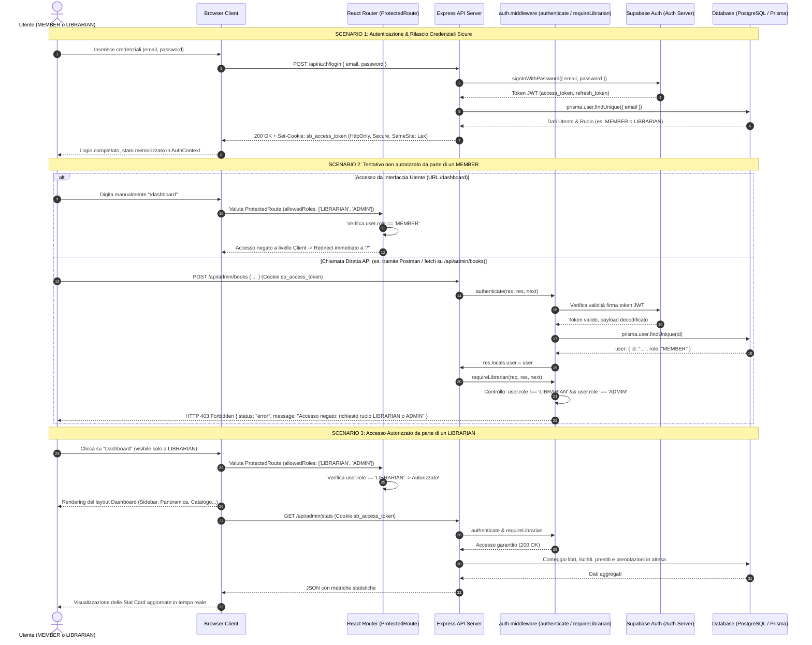

## Diagramma di Sequenza: Autenticazione e Controllo degli Accessi (RBAC)

Questo diagramma illustra come il sistema applicativo gestisce l'accesso alle risorse protette, verificando l'identità dell'utente e impedendo l'accesso non autorizzato a rotte o API riservate (es. un utente con ruolo `MEMBER` che tenta di accedere alla `/dashboard` o alle API `/api/admin/*`).

