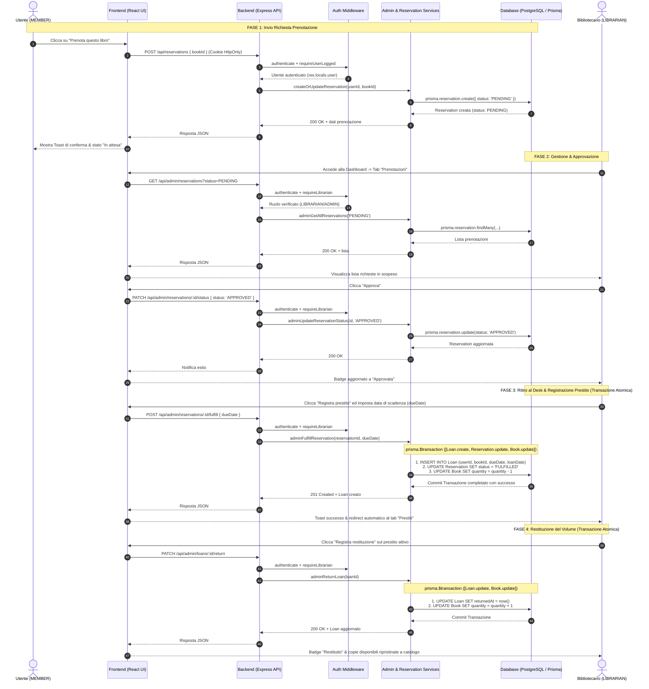

## Diagramma di Sequenza: Ciclo di Vita Prenotazione e Prestito

Questo diagramma illustra lo scenario end-to-end che collega la richiesta di prenotazione inviata dall'utente (`MEMBER`) con la gestione, approvazione ed evasione in prestito da parte del bibliotecario (`LIBRARIAN`), fino alla restituzione finale con ripristino della copia disponibile.

