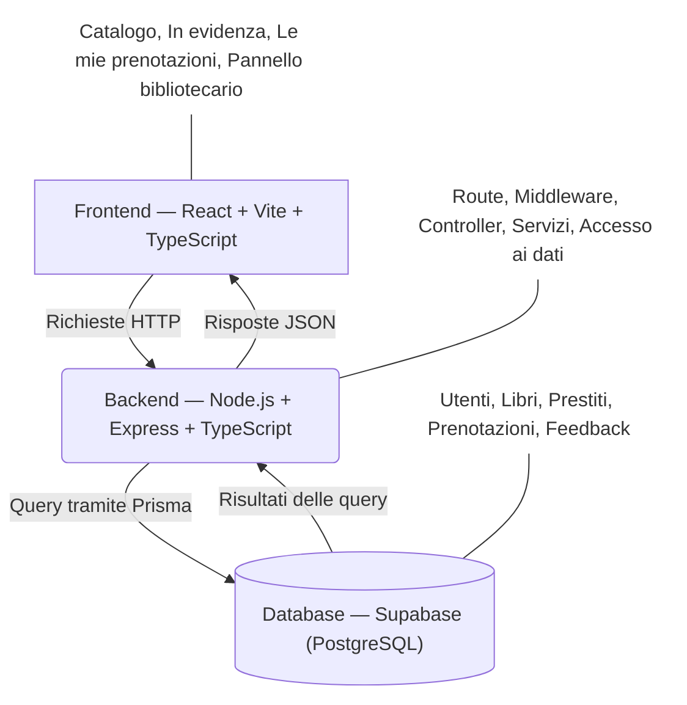

## Stack tecnologico

Il diagramma mostra l'architettura tecnologica della webapp e mostra come i diversi livelli del isstema interagiscono tra loro: il frontend comunica tramite richieste HTTP con il backend, che si occupa della logica di business e dell'accesso ai dati tramite Prisma. I dati vengono poi persistiti nel database PostgreSQL gestito tramite Supabase

