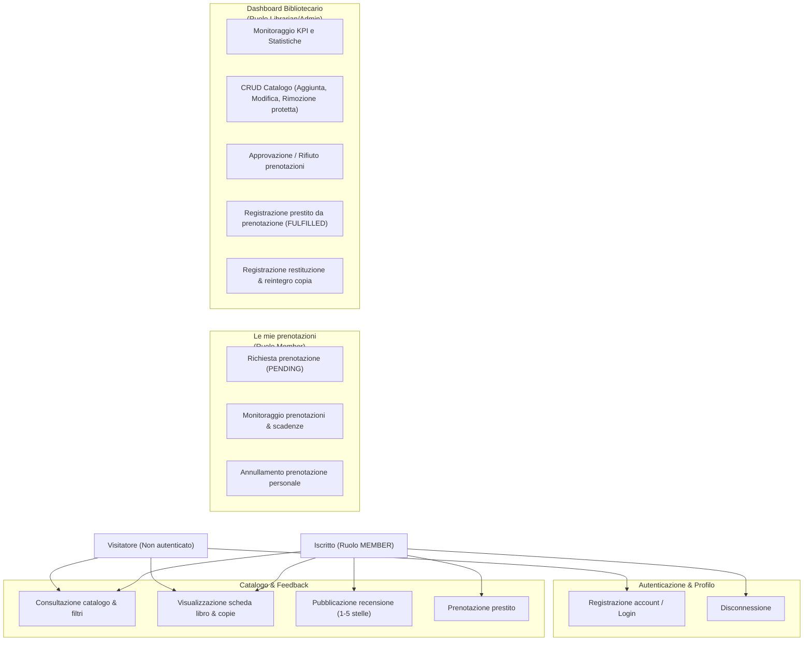

## Diagramma dei Casi d'Uso (Use Case Diagram)

Il seguente diagramma descrive gli attori del sistema (**Visitatore non autenticato**, **Iscritto / Member** e **Bibliotecario / Admin**) e le relative interazioni con la piattaforma Hubiblio.

