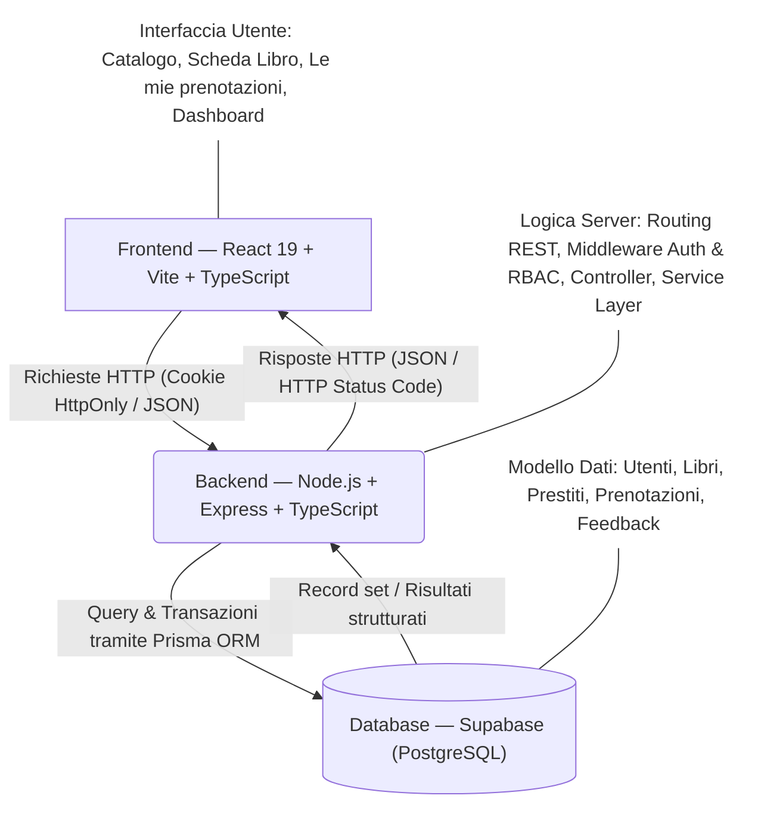
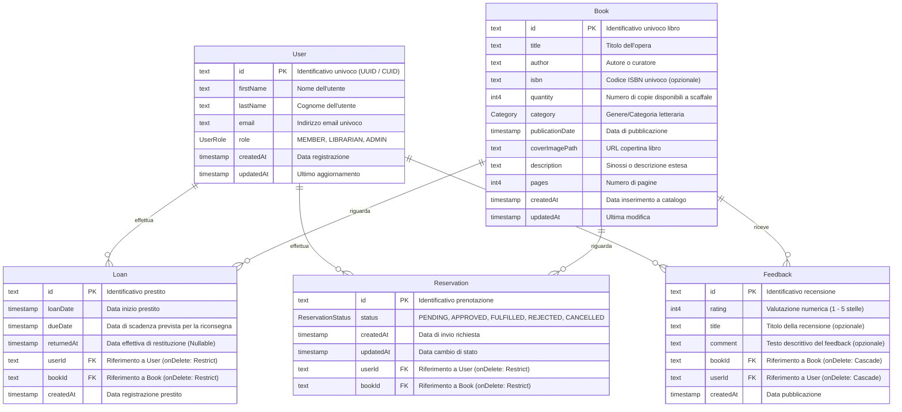
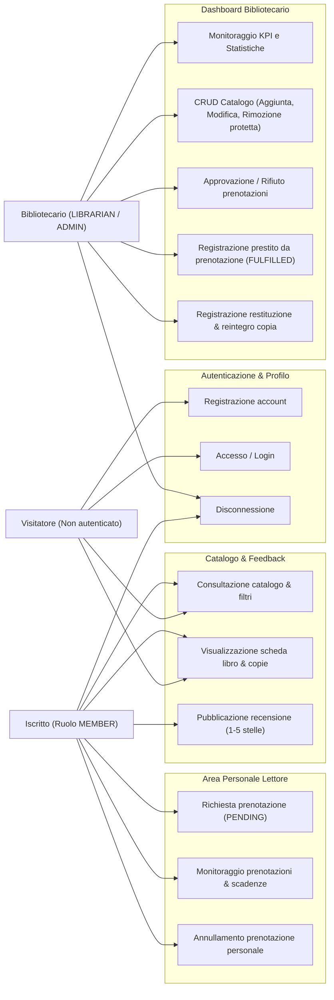
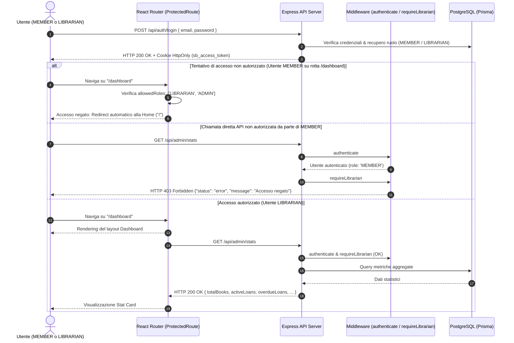
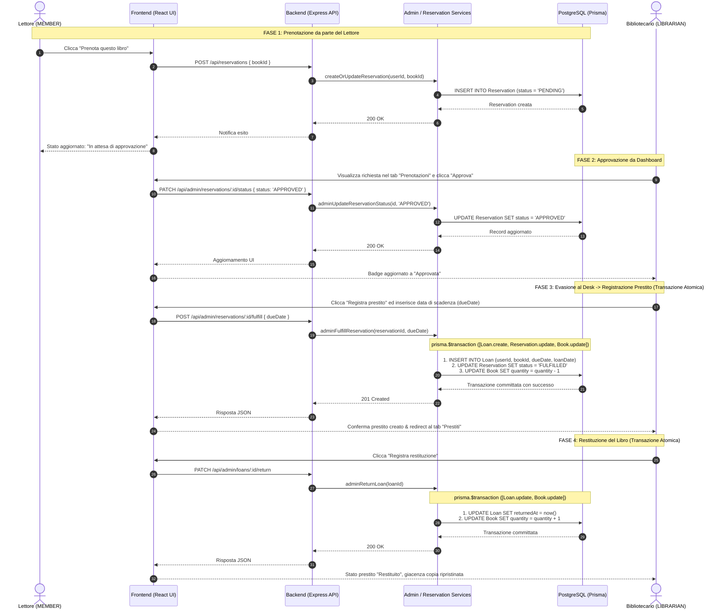

# Documentazione Tecnica del Prototipo e Scenari d'Uso

La presente sezione documenta l'architettura tecnica, il modello dati, i casi d'uso e gli scenari operativi del prototipo sviluppato per la piattaforma di gestione bibliotecaria **Hubiblio**, in conformità con i requisiti del Project Work nell'area scientifico-disciplinare **INF/01 (Informatica)**.

---

## 1. Architettura di Sistema e Stack Tecnologico

Il sistema adotta un'architettura **client-server a tre livelli (Three-Tier Architecture)**, separando nettamente il livello di presentazione, la logica applicativa e il livello di memorizzazione persistente:

1. **Livello di Presentazione (Frontend Web):** Realizzato come Single Page Application (SPA) reattiva con **React 19**, **Vite** e **TypeScript**, stilizzata mediante CSS Modules nativi.
2. **Livello Applicativo (Backend & API RESTful):** Server REST sviluppato con **Node.js**, **Express** e **TypeScript**, responsabile della logica di business, dell'autenticazione, della validazione dell'input e dell'autorizzazione basata sui ruoli (RBAC).
3. **Livello dei Dati (Storage & Database Relazionale):** Database **PostgreSQL** ospitato su infrastruttura cloud **Supabase**, interfacciato dal backend attraverso l'Object-Relational Mapping (ORM) **Prisma** con client tipizzato.

### 1.1 Concetti di Elaborazione, Memorizzazione e Comunicazione (INF/01)

- **Elaborazione:** Distribuita tra client (rendering dichiarativo, gestione dello stato con React Context, filtri dinamici lato visualizzazione) e server (elaborazione delle regole di business, autorizzazione crittografica delle sessioni, aggregazione analitica dei dati).
- **Memorizzazione:** La persistenza garantisce proprietà **ACID** (Atomicità, Coerenza, Isolamento, Durabilità). I dati transazionali (es. evasione di una prenotazione con emissione prestito e decremento copie) vengono eseguiti all'interno di blocchi transazionali atomici (`prisma.$transaction`).
- **Comunicazione:** Avviene su protocollo HTTP/HTTPS mediante API REST stateless. L'autenticazione e la persistenza dell'identità sono delegate a **Cookie HttpOnly (`sb_access_token`)** con policy `SameSite: Lax`, proteggendo l'applicazione da attacchi di tipo Cross-Site Scripting (XSS) e manomissione client-side dei token JWT emessi da Supabase Auth.

---

## 2. Modello dei Dati (Diagramma Entità-Relazione)

La base di dati relazionale modella i processi cardine dell'impresa culturale: la catalogazione del patrimonio librario, l'anagrafica utenti, il ciclo di vita delle prenotazioni, la gestione dei prestiti e la raccolta di recensioni/feedback.

### 2.1 Integrità Referenziale e Vincoli di Dominio
- **Vincoli `onDelete: Restrict` su `Reservation` e `Loan`:** Impediscono la cancellazione accidentale di un volume o di un utente fintanto che sussistono contratti di prestito o prenotazioni in essere.
- **Vincolo `onDelete: Cascade` su `Feedback`:** Qualora un libro o un utente vengano definitivamente rimossi, le recensioni collegate vengono rimosse a cascata per prevenire record orfani.
- **Enumeratori:**
  - `UserRole`: `MEMBER`, `LIBRARIAN`, `ADMIN`.
  - `ReservationStatus`: `PENDING` (richiesta inviata), `APPROVED` (accettata, volume pronto al desk), `FULFILLED` (ritirato e commutato in prestito), `REJECTED` (rifiutata dal bibliotecario), `CANCELLED` (annullata dal lettore).
  - `Category`: `FANTASY`, `THRILLER`, `HORROR`, `DRAMA`, `COMEDY`, `ACTION`, `ADVENTURE`, `SCI_FI`, `MYSTERY`, `ROMANCE`, `BUSINESS`, `OTHER`.

---

## 3. Diagramma Generale dei Casi d'Uso (Use Case Diagram)

Il sistema supporta tre profili di utenza, ciascuno con specifiche autorizzazioni:
- **Visitatore (Guest):** Consultazione anonima del catalogo, ricerca e registrazione/login.
- **Iscritto (Member):** Prenotazione volumi, gestione delle proprie richieste, visualizzazione prestiti attivi e invio di feedback/recensioni.
- **Bibliotecario / Amministratore (Librarian / Admin):** Gestione completa del catalogo (CRUD), approvazione/rifiuto prenotazioni, formalizzazione dei prestiti al banco, registrazione restituzioni e monitoraggio analitico (KPI).

---

## 4. Scenari d'Uso Dettagliati e Diagrammi di Sequenza

### 4.1 Scenario d'Uso 1: Autenticazione e Controllo degli Accessi (RBAC)

* **Attori:** Utente con ruolo `MEMBER`, Utente con ruolo `LIBRARIAN`.
* **Pre-condizioni:** L'utente accede alla piattaforma.
* **Descrizione del Flusso:**
  1. L'utente invia credenziali via `POST /api/auth/login`.
  2. Il server valida le credenziali con Supabase Auth e legge il profilo su PostgreSQL; se valido, deposita il cookie crittografato `sb_access_token` nel browser.
  3. Il frontend (`AuthContext`) aggiorna l'identità dell'utente. Se l'utente è un `LIBRARIAN`, nella Navbar compare il link "Dashboard".
  4. Se un utente `MEMBER` tenta di forzare l'URL `/dashboard`, il componente React `ProtectedRoute` intercetta la violazione tramite la prop `allowedRoles={['LIBRARIAN', 'ADMIN']}` e reindirizza immediatamente il browser alla Home (`/`).
  5. Se un client malevolo tenta di interrogare direttamente le API `/api/admin/*`, la catena di middleware `authenticate` + `requireLibrarian` risponde con codice HTTP `403 Forbidden`.

---

### 4.2 Scenario d'Uso 2: Ciclo di Vita Prenotazione, Evasione in Prestito e Restituzione

* **Attori:** Utente Iscritto (`MEMBER`), Bibliotecario (`LIBRARIAN`).
* **Pre-condizioni:** Libro presente a catalogo; utente autenticato.
* **Descrizione del Flusso:**
  1. **Invio richiesta:** L'utente apre la scheda libro (`/books/:id`) e clicca su "Prenota questo libro". Il backend crea un record `Reservation` con stato `PENDING`.
  2. **Approvazione:** Il bibliotecario consulta la sezione "Prenotazioni" della Dashboard, riscontra la disponibilità della copia e clicca "Approva". Lo stato transita ad `APPROVED`.
  3. **Ritiro al banco & Evasione:** L'utente si reca in biblioteca. Il bibliotecario clicca "Registra prestito", inserisce la data di scadenza (default: 30 giorni) e conferma.
  4. **Transazione Atomica ($transaction):**
     - Viene inserito un record `Loan` con `loanDate: now()` e `dueDate`.
     - La `Reservation` collegata viene aggiornata a stato `FULFILLED`.
     - La disponibilità del volume (`Book.quantity`) viene decrementata di 1.
  5. **Restituzione:** Alla riconsegna fisica del libro, il bibliotecario clicca "Registra restituzione" nella sezione "Prestiti". Una transazione atomica imposta `returnedAt: now()` e incrementa nuovamente `Book.quantity` di 1.

---

### 4.3 Scenario d'Uso 3: Gestione del Catalogo da parte del Bibliotecario

* **Attori:** Bibliotecario (`LIBRARIAN` o `ADMIN`).
* **Pre-condizioni:** Accesso eseguito con privilegi amministrativi.
* **Descrizione del Flusso:**
  1. Il bibliotecario seleziona la sezione "Catalogo" della Dashboard.
  2. **Aggiunta Volume:** Cliccando su "Aggiungi libro", si apre un form modale che richiede titolo, autore, genere (`Category`), codice ISBN, anno di pubblicazione, numero di pagine, quantità disponibile, descrizione e URL della copertina.
  3. L'invio genera una richiesta `POST /api/admin/books`, memorizzando la nuova scheda nel database.
  4. **Modifica Volume:** Cliccando su "Modifica", il modale viene precompilato con i dati attuali; al salvataggio viene invocata la rotta `PATCH /api/admin/books/:id`.
  5. **Cancellazione Protetta:** Se il bibliotecario tenta di eliminare un libro, il servizio applicativo verifica prima che non vi siano prestiti non restituiti (`returnedAt: null`) o prenotazioni attive (`PENDING` o `APPROVED`). In caso di conflitti, l'eliminazione viene respinta con apposito messaggio di errore, garantendo l'integrità del patrimonio e dei contratti in essere.

---

### 4.4 Scenario d'Uso 4: Consultazione Catalogo e Invio Recensioni (Feedback)

* **Attori:** Visitatore (lettura) o Iscritto `MEMBER` (lettura e invio recensione).
* **Descrizione del Flusso:**
  1. L'utente naviga la Home Page o il Catalogo filtrando per parola chiave, categoria o ordinamento (per titolo, anno o valutazione media).
  2. Cliccando su un volume, accede alla pagina di dettaglio (`/books/:id`) che espone la disponibilità, la scheda bibliografica e le recensioni storiche aggregate.
  3. Se autenticato, l'utente può compilare il box di recensione selezionando un punteggio da 1 a 5 stelle, un titolo e un commento testuale.
  4. L'invio invoca `POST /api/books/new-feedback`, protetta dai middleware `authenticate` e `requireUserLogged`.
  5. Il backend registra il record `Feedback` associandolo all'ID utente verificato e ricalcola la media aggregata mostrata dinamicamente nell'interfaccia.

---

## 5. Specifiche delle API RESTful

La tabella seguente riassume l'interfaccia di comunicazione esposta dal backend:

| Metodo | Endpoint | Ruolo Richiesto | Descrizione |
|---|---|---|---|
| `POST` | `/api/auth/register` | Pubblico | Registrazione di un nuovo lettore (`MEMBER`) |
| `POST` | `/api/auth/login` | Pubblico | Autenticazione e rilascio cookie HttpOnly |
| `POST` | `/api/auth/logout` | Autenticato | Revoca della sessione e cancellazione cookie |
| `GET` | `/api/auth/me` | Autenticato | Ritorna il profilo dell'utente loggato |
| `GET` | `/api/books` | Pubblico | Ricerca e consultazione catalogo con filtri |
| `GET` | `/api/books/:id` | Pubblico | Scheda dettagliata del singolo volume e recensioni |
| `POST` | `/api/books/new-feedback` | Autenticato (`MEMBER`) | Invio di valutazione e commento |
| `POST` | `/api/reservations` | Autenticato (`MEMBER`) | Creazione nuova richiesta di prenotazione |
| `GET` | `/api/reservations/my` | Autenticato (`MEMBER`) | Elenco prenotazioni e prestiti personali |
| `GET` | `/api/reservations/check/:bookId` | Autenticato (`MEMBER`) | Verifica stato prenotazione per un dato libro |
| `PATCH` | `/api/reservations/:id/cancel` | Autenticato (`MEMBER`) | Annullamento di una prenotazione `PENDING`/`APPROVED` |
| `GET` | `/api/admin/stats` | `LIBRARIAN` / `ADMIN` | Metriche sintetiche dashboard (KPI) |
| `POST` | `/api/admin/books` | `LIBRARIAN` / `ADMIN` | Inserimento nuovo libro a catalogo |
| `PATCH` | `/api/admin/books/:id` | `LIBRARIAN` / `ADMIN` | Aggiornamento metadati di un libro |
| `DELETE` | `/api/admin/books/:id` | `LIBRARIAN` / `ADMIN` | Eliminazione libro (con controllo prestiti attivi) |
| `GET` | `/api/admin/reservations` | `LIBRARIAN` / `ADMIN` | Elenco di tutte le prenotazioni con filtro stato |
| `PATCH` | `/api/admin/reservations/:id/status` | `LIBRARIAN` / `ADMIN` | Modifica stato prenotazione (`APPROVED`, `REJECTED`, ecc.) |
| `POST` | `/api/admin/reservations/:id/fulfill` | `LIBRARIAN` / `ADMIN` | Evasione prenotazione con creazione prestito |
| `GET` | `/api/admin/loans` | `LIBRARIAN` / `ADMIN` | Elenco generale dei prestiti (attivi, scaduti, restituiti) |
| `PATCH` | `/api/admin/loans/:id/return` | `LIBRARIAN` / `ADMIN` | Registrazione restituzione e reintegro scorta |

---

## 6. Mappatura dei Test Funzionali e Riscontri Visivi (Screenshot)

A supporto della verifica del corretto funzionamento degli scenari sopra descritti, la documentazione include gli screenshot conservati nella cartella `documents/screenshots/`:

| Scenario di Test | Descrizione e Funzionalità Verificata | File Screenshot Correlato |
|---|---|---|
| **Home Page & Vetrina** | Consultazione del catalogo, libri in evidenza e filtri di ricerca | `home.png` |
| **Dettaglio Libro & Feedback** | Scheda volume, calcolo dinamico rating medio e modulo recensioni | `bookDetail.png` |
| **Azione Prenotazione loading** | Interfaccia mostra loading durante l'invio della prenotazione | `sendReserving.png` |
| **Prenotazione in attesa** | Interfaccia mostra la prenotazione in attesa di approvazione | `reservationPending.png` |
| **Prenotazione approvata** | Interfaccia mostra la prenotazione del libro approvata | `reservationApproved.png` |
| **Libro in prestito** | Interfaccia mostra il libro attualmente in prestito | `reservationFulfilled.png` |
| **Autenticazione & Accesso** | Moduli di registrazione nuovo utente e login sicuro | `register.png`, `login.png` |
| **Navbar & Ruoli Utente** | Visualizzazione dinamica delle opzioni in base al ruolo (`MEMBER` vs `LIBRARIAN`) | `navbarMember.png`, `navbarLibrarian.png` |
| **Area Personale Iscritto** | Sezione "I miei libri" con storico prenotazioni, stati e prestiti in corso | `myBooks.png` |
| **Dashboard Bibliotecario (KPI)** | Panoramica sintetica con 5 indicatori chiave (libri, iscritti, prestiti, scadenze) | `dashboard.png` |
| **Gestione Catalogo (CRUD)** | Tabella libri con azioni di modifica e rimozione protetta | `catalogManagement.png` |
| **Nuovo Volume a Catalogo** | Modale per l'aggiunta di un libro con campi bibliografici e giacenza | `addNewBooksModal.png` |
| **Modifica Volume a Catalogo** | Modale per la modifica di un libro con campi bibliografici e giacenza | `editBookModal.png` |
| **Gestione Prenotazioni** | Interfaccia per approvare, rifiutare ed evadere le prenotazioni degli utenti | `reservationsManagement.png` |
| **Monitoraggio Prestiti** | Elenco prestiti attivi, scaduti e gestione restituzione al desk | `loansManegement.png` |

